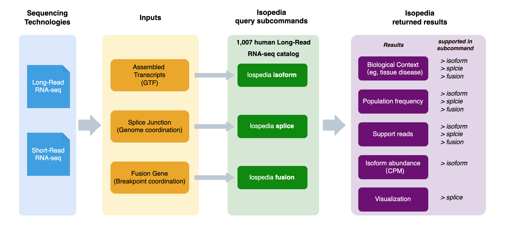
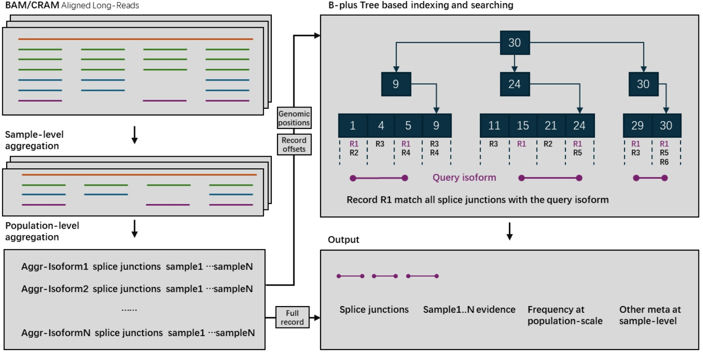
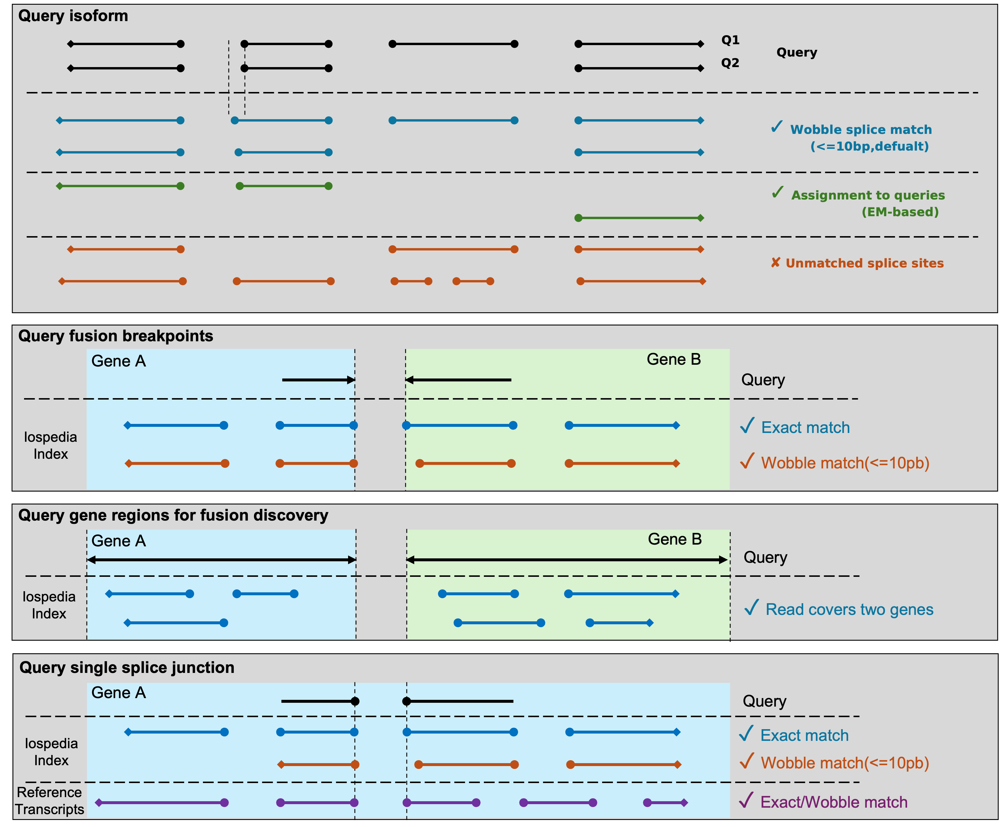

# About Isopedia 

**Isopedia** is a scalable tool for analyzing hundreds to thousands of long-read transcriptome datasets using a read-level indexing approach.

It provides two key capabilities:

- Population-level transcript quantification and frequency profiling.
- Isoform diversity exploration, including fusion and splice-junction analysis.

preprint: [https://www.biorxiv.org/content/10.64898/2026.03.23.713667v1.full](https://www.biorxiv.org/content/10.64898/2026.03.23.713667v1.full)

**Stable release: [v1.7.3](https://github.com/zhengxinchang/isopedia/releases/tag/v1.7.3).**

Use this release with the pre-built indexes provided below.
The `main` branch maintains the stable 1.x series.


## Table of Contents

- [Quick Start](#quick-start)
- [How It Works](#how-it-works)
- [Download Pre-built Index](#download-pre-built-index)
- [Build Your Own Index](#build-your-own-index)
- [How to Use Isopedia](#how-to-use-isopedia)
  - [Isoform Query](#isoform-query)
  - [Fusion Query and Discovery](#fusion-query-and-discovery)
  - [Splice Query and Visualization](#splice-query-and-visualization)
- [Command Parameters](#command-parameters)
- [How to Install Isopedia](#how-to-install-isopedia)
- [Next version (2.x)](#next-version-2x)
<!-- - [Annotate ORF with ORFannotate](#annotate-orf-with-orfannotate) -->
- [Computational Resource Usage](#computational-resource-usage)
- [FAQ](#faq)

## Quick Start

Isopedia has two binaries:

- `isopedia`: main workflows (query + index building)
- `isopedia-tools`: helper utilities

```bash
# download the stable release for the current pre-built indexes
mkdir -p isopedia-bin
curl -fL https://github.com/zhengxinchang/isopedia/releases/download/v1.7.3/isopedia-v1.7.3-linux-x86_64.tar.gz | tar -xzvf - -C isopedia-bin
./isopedia-bin/isopedia --version
export PATH="$PWD/isopedia-bin:$PATH"

# clone the repo and enter toy example directory
git clone --branch main https://github.com/zhengxinchang/isopedia && cd isopedia/toy_ex/

# query transcripts
isopedia isoform -i index/ -g gencode.v47.basic.chr22.gtf -o out.profile.tsv.gz # 3364 records returned

# query one splice junction
isopedia splice -i index/ -s 22:17744013,22:17750104 -o out.splice.tsv.gz # 13 records returned

# visualize splice query output
python3 ../script/isopedia-splice-viz.py -i out.splice.tsv.gz -g gencode.v47.basic.chr22.gtf -t ../script/isopedia-splice-viz-temp.html -o isopedia-splice-view

# query one fusion event (two breakpoints)
isopedia fusion -i index/ -p chr1:181130,chr1:201853853 -o ./out.fusion.tsv.gz # no matching records in the toy index

# query multiple fusion events
isopedia fusion -i index/ -P fusion_query.tsv -o ./out.fusion.tsv.gz # no matching records in the toy index

```


Overview of Isopedia's query framework and supported output types. All query modes run on a standard laptop.




<!-- For GTF indexing details, see [Indexing GTF Files](doc/indexing_gtf.md). -->

## How It Works



Typical workflow:

1. `isopedia profile`: extract isoform signals per sample.
2. `isopedia merge`: aggregate all profiles into one merged archive.
3. `isopedia index`: build tree index for fast query.
4. Query with `isopedia isoform`, `isopedia fusion`, or `isopedia splice`.

<details>
<summary><strong>How Isopedia determines a positive hit for a query transcript</strong></summary>



</details>

## Download Pre-built Index

Isopedia provides pre-built indexes from public long-read RNA-seq datasets.

These indexes use the 1.x format and are supported by v1.7.3. They are not compatible with the new format on `next`.

| Name | Organism | Reference | Link | Sample Size | Index Size (Compressed) | Minimum Memory for Query | Description |
|---|---|---|---|---:|---|---|---|
| `isopedia_index_hs_v1.0` | *Homo sapiens* | GRCh38 | `ftp://hgsc-sftp1.hgsc.bcm.tmc.edu/rt38520/isopedia_index_hs_v1.0.tar.xz` | 1,007 | 305G (107G) | 16 GB | 107 ENCODE samples + 900 SRA samples |

Checksum file:

- `ftp://hgsc-sftp1.hgsc.bcm.tmc.edu//rt38520/isopedia_index_hs_v1.0.tar.xz.md5sum`
<!-- 
### Download with `isopedia download`

```bash
# list indexes from the default remote manifest
isopedia download --list

# download a named index from the default manifest
isopedia download --name isopedia_index_hs_v1.0.tar.xz --outdir ./downloads

# download from custom URL
isopedia download --url ftp://hgsc-sftp1.hgsc.bcm.tmc.edu//rt38520/isopedia_index_hs_v1.0.tar.xz --outdir ./downloads

# use custom manifest TOML
isopedia download --manifest /path/to/manifest.toml --name isopedia_index_hs_v1.0.tar.xz --outdir ./downloads

```

Example custom manifest entry:

```toml
[[index]]
name = "isopedia_index_hs_v1.0.tar.xz"
url = "ftp://hgsc-sftp1.hgsc.bcm.tmc.edu//rt38520/isopedia_index_hs_v1.0.tar.xz"
size = 114596438692
md5 = "eb922ef27257d363969a835d4175da26"
source = "ftp"
protocol = "ftp"
description = "Human pre-built index (GRCh38)"
``` -->

Unpack:

```bash
tar -xvf isopedia_index_hs_v1.0.tar.xz
```

## Build Your Own Index

Prerequisites:

<!-- 1. Long-read alignments (`.bam`/`.cram`) or transcript annotations (`.gtf`). -->
1. Long-read alignments (`.bam`/`.cram`)
2. A manifest TSV with a header row and at least two columns: sample name and profile path. Use unique sample names; additional columns contain sample metadata. Relative paths are resolved from the working directory where you run Isopedia.

For CRAM input, provide the matching reference FASTA with `profile --reference reference.fa`.

Example manifest:

```tsv
name	path	platform
HG002_pb_chr22	/path/to/hg002_pb_chr22.isoform.gz	PacBio
HG002_ont_chr22	/path/to/hg002_ont_chr22.isoform.gz	ONT
```

Workflow:

```bash
# 1) profile each sample
isopedia profile -i ./chr22.pb.grch38.bam -o ./hg002_pb_chr22.isoform.gz
isopedia profile -i ./chr22.ont.grch38.bam -o ./hg002_ont_chr22.isoform.gz

# 2) merge profiles
ulimit -n 65535 # increase the maximum number of open file descriptors, in case of merging many samples.
isopedia merge -i manifest.tsv -o index/

# 3) build tree index
isopedia index -i index/ -m manifest.tsv

# 4) test query
isopedia isoform -i index/ -g gencode.v47.basic.chr22.gtf -o out.isoform.tsv.gz
```

## How to Use Isopedia

### Isoform Query

Purpose:

- Annotate transcripts from an input GTF against the index.

The GTF must contain a `transcript` record followed by its corresponding `exon` records, with `gene_id`, `transcript_id`, and strand information. Plain-text and gzip-compressed GTF files are supported. Sorting individual lines by genomic position alone can break transcript/exon grouping.

Example:

```bash
# normalize and regroup transcript/exon records (requires gffread)
gffread -T -o- origin.gtf | sort -k1,1 -k4,4n | gffread -T - -o query.sorted.gtf

isopedia isoform -i index/ -g query.sorted.gtf -o isoform.out.tsv.gz
```

#### Output columns (v1.7.3)

| Column | Description |
|---|---|
| `chrom` | Chromosome, normalized to uppercase without the `chr` prefix |
| `start` | Transcript start, 0-based |
| `end` | Transcript end, exclusive |
| `length` | Sum of exon lengths |
| `exon_count` | Exon count |
| `trans_id` | Transcript ID |
| `gene_id` | Gene ID |
| `ranking_score` | Reserved field; always `NA` in v1.7.3 |
| `detected` | Direct detection status based on full-splice-match read support (`RC_FSM_JC`) and `min_read`. EM estimates do not determine detection. |
| `min_read` | Minimum read threshold used |
| `n_pos_samples/sample_size` | Number of samples with direct detection support and total sample size |
| `attributes` | Transcript GTF attributes serialized as `key:value;...` |
| `FORMAT` | Per-sample field format: `RC_FSM_JC:RC_FSM_JC_TSS:RC_FSM_JC_TES:RC_FSM_JC_TSS_TES:RC_FSM_JC_EXACT:RC_FSM_JC_WOBBLE_ONLY:RC_EM_ISM:CPM_FSM_JC:CPM_FSM_JC_TSS_TES:CPM_EST:FRAC_FSM_JC_TSS:FRAC_FSM_JC_TES:FRAC_FSM_JC_TSS_TES`. |
| Sample-name columns | Per-sample values; column names come from the index manifest |


**CPM values use each sample's total indexed evidence as the denominator, so querying a subset of transcripts does not change that denominator.**


### Fusion Query and Discovery

`fusion` supports three modes:

1. Breakpoint query (`--pos` or `--pos-bed`)
2. Gene-region discovery (`--gene-gtf`)
3. Region-pair detailed read output (`--region`)

Examples:

```bash
# single breakpoint pair
isopedia fusion -i index/ -p chr1:1000,chr2:2000 -o ./fusion.single.tsv.gz

# batch breakpoint pairs from a five-column TSV
isopedia fusion -i index/ -P fusion_breakpoints.tsv -o ./fusion.batch.tsv.gz

# discover candidate fusions from gene GTF
isopedia fusion -i index/ -G gene.gtf -o ./fusion.discovery.tsv.gz

# detailed read-level output for two regions
isopedia fusion -i index/ -r chr8:92017266-92017466,chr21:34859374-34859574 -o ./fusion.region.tsv.gz
```

Choose one query mode per command. In v1.7.3, the output path must include an existing parent directory; use `./output.tsv.gz` for the current directory.

`--pos-bed` reads five tab-separated columns, without a header: `chr1`, `pos1`, `chr2`, `pos2`, `id`. Despite the option name and CLI help, this is not a six-column BEDPE file.

```tsv
chr1	1000	chr2	2000	fusion_1
```

Positions use 0-based genomic boundaries. For `--gene-gtf`, provide an uncompressed GTF with gene records followed by their exons, including `gene_id`, `gene_name`, and `gene_type`; discovery matches protein-coding genes.

Breakpoint-query output columns:

- `chr1`, `pos1`, `chr2`, `pos2`, `id`, `min_read`, `positive/sample_size`, `left_isoforms`, `right_isoforms`, `FORMAT` (`COUNT`), then per-sample counts.

Gene-discovery output limitation in v1.7.3:

- The header declares eight separate start/end columns after `is_two_strand`, but each data row writes four `chr:start-end` fields instead (A-to-B primary, A-to-B supplementary, B-to-A primary, B-to-A supplementary), followed by `FORMAT` and sample counts. The header and data therefore do not align; account for this before parsing this mode's output.

Region-pair detailed output columns:

- `chr1`, `start1`, `end1`, `chr2`, `start2`, `end2`, `main_exon_count1`,
  `supp_segment_count2`, `query_part`, `main_isoforms`, `supp_aln_regions`, `sample_name`.

In v1.7.3, the region-pair header also appends an unused `FORMAT` column and an empty trailing field; data rows contain only the 12 columns listed above.

### Splice Query and Visualization

Purpose:

- Query isoforms overlapping a splice junction and optionally visualize them.

Examples:

```bash
# single splice query
isopedia splice -i index/ -s chr22:41100500,chr22:41101500 -o splice.out.tsv.gz

# batch splice query
isopedia splice -i index/ -S splice_queries.bed -o splice.batch.tsv.gz

# visualize
python3 script/isopedia-splice-viz.py \
  -i splice.out.tsv.gz \
  -g gencode.v47.basic.annotation.gtf \
  -t script/isopedia-splice-viz-temp.html \
  -o isopedia-splice-view
```

Run the visualization command above from the repository root; Python 3 is required. For `--splice-bed`, use the same five-column TSV layout as fusion breakpoint input, with both positions on the same chromosome and the left coordinate first. Splice positions are 0-based boundaries: for consecutive GTF exons, use the left exon's end and the right exon's start minus one.

`splice` output columns:

- `id`, `chr1`, `pos1`, `chr2`, `pos2`, `total_evidence`, `cpm`, `matched_sj_idx`,
  `dist_to_matched_sj`, `n_exons`, `start_pos_left`, `start_pos_right`,
  `end_pos_left`, `end_pos_right`, `splice_junctions`, `FORMAT`, then per-sample values.

Additional explaination:
```
start_pos_left: the smallest observed start position among all reads supporting this isoform
start_pos_right: the largest observed start position among all reads supporting this isoform
end_pos_left: the smallest observed end position among all reads supporting this isoform
end_pos_right: the largest observed end position among all reads supporting this isoform
```


`splice` per-sample `FORMAT`:

- `COUNT:CPM:START|END|STRAND`

## Command Parameters

Parameter lists below describe the v1.7.3 CLI on the stable 1.x branch.

### `isopedia isoform`

Core options:

- `-i, --idxdir <IDXDIR>`
- `-g, --gtf <GTF>`
- `-o, --output <OUTPUT>`
- `-f, --flank <FLANK>` (default: `10`; multi-exon junction matching tolerance)
- `-F, --mono-exon-wobble <MONO_EXON_WOBBLE>` (default: `50`; expands the mono-exon candidate search interval by this many bp on each side, and requires both read ends to be within this distance of the annotated ends for FSM)
- `-m, --min-read <MIN_READ>` (default: `1`)
- `--info` (accepted, but does not add output fields in v1.7.3)
- `-n, --num-threads <NUM_THREADS>` (default: `4`)
- EM options: `--em-max-iter`, `--em-conv-min-diff`, `--em-chunk-size`, `--em-effective-len-coef`, `--em-damping-factor`, `--min-em-abundance`
- TSS/TES options: `--tss-wob`, `--tes-wob` (both default to `50`). The wobble values are maximum absolute deviations in bp and apply in both directions around the annotated TSS and TES. `--no-check-tss-tes` is deprecated; TSS/TES support is always counted.
- Cache options: `-c, --cached-nodes`, `--cached-chunk-num`, `--cached-chunk-size-mb`
- `--output-tmp-shard-counts`
- `--verbose`

### `isopedia fusion`

Core options:

- `-i, --idxdir <IDXDIR>`
- Query selectors: `-p, --pos`, `-P, --pos-bed`, `-r, --region`, `-G, --gene-gtf`
- `-o, --output <OUTPUT>`
- `-f, --flank <FLANK>` (default: `10`)
- `-m, --min-read <MIN_READ>` (default: `1`; used to count positive samples in breakpoint mode only)
- Cache options: `-c, --cached_nodes`, `--cached-chunk-number`, `--cached-chunk-size-mb`
- `--verbose`

### `isopedia splice`

Core options:

- `-i, --idxdir <IDXDIR>`
- Query selectors: `-s, --splice` or `-S, --splice-bed`
- `-o, --output <OUTPUT>`
- `-f, --flank <FLANK>` (default: `10`; both junction boundary distances must be strictly less than this value in v1.7.3. Use `1` for exact matching; `0` returns no records.)
- `-m, --min-read <MIN_READ>` (default: `1`; accepted but does not filter results in v1.7.3)
- Cache options: `-c, --cached_nodes`, `--cached-chunk-number`, `--cached-chunk-size-mb`
- `--verbose`

### `isopedia profile`

Core options:

- Input selectors: `-i, --bam` or `-g, --gtf` (GTF input is supported but hidden from CLI help)
- `-r, --reference <REFERENCE>` for CRAM
- `-o, --output <OUTPUT>`
- `--mapq <MAPQ>` (default: `5`)
- `--use-secondary`, `--rname`, `--verbose`
- `--tid`, `--gid` (GTF input only; hidden from CLI help)
- `--stats` (writes alignment statistics to `<output>.stats.txt`)

### `isopedia merge`

Core options:

- `-i, --input <INPUT>`
- `-o, --outdir <OUTDIR>`
- `-c, --chunk-size <CHUNK_SIZE>` (default: `1000000`)

### `isopedia index`

Core options:

- `-i, --idxdir <IDXDIR>`
- `-m, --manifest <MANIFEST>`
- `-t, --threads <THREADS>` (default: `4`)

### `isopedia download` (beta)

Core options:

- `-l, --list`
- `-n, --name <NAME>`
- `-u, --url <URL>`
- `-m, --manifest <MANIFEST>`
- `-o, --outdir <OUTDIR>` (default: `.`)

## How to Install Isopedia

We offer two ways to install isopedia:

### 1. Download v1.7.3 (recommended for current pre-built indexes)

Download the pre-built binary from the [v1.7.3 release page](https://github.com/zhengxinchang/isopedia/releases/tag/v1.7.3):

```bash
mkdir -p isopedia-bin
curl -fL https://github.com/zhengxinchang/isopedia/releases/download/v1.7.3/isopedia-v1.7.3-linux-x86_64.tar.gz | tar -xzvf - -C isopedia-bin
./isopedia-bin/isopedia --version
export PATH="$PWD/isopedia-bin:$PATH"
```

### 2. Build from source (for users want to build from source)

Rust and Cargo are required.

```bash
git clone --branch main https://github.com/zhengxinchang/isopedia.git
cd isopedia
cargo build --release --locked
export PATH="$PWD/target/release:$PATH"
```

<!-- ## Annotate ORF with ORFannotate

Isopedia interoperates with [ORFannotate](https://github.com/egustavsson/ORFannotate), which can consume Isopedia outputs to predict ORFs/UTRs and annotate CDS features.

```text
<placeholder>
``` -->

## Next version (2.x)

Isopedia 2.x is under development and introduces a new profile and index
format that is incompatible with the existing 1.x data.

- [`dev`](https://github.com/zhengxinchang/isopedia/tree/dev):
  fixes and compatible updates for the current 1.x series.
- [`next`](https://github.com/zhengxinchang/isopedia/tree/next):
  development of the next major version, 2.x.

For current pre-built indexes, continue using the stable 1.x release.

To use the new format, regenerate profiles from the original inputs and
run `profile` → `merge` → `index`, writing to a separate directory.
Existing 1.x profiles and indexes cannot be reused directly.

## Computational Resource Usage

Isopedia 1.4.0 benchmark on 1,007 long-read transcriptome datasets from SRA and ENCODE.

- Hardware: AMD Ryzen 9 7940HX, 64 GB RAM.

| Step | Peak Mem (GB) | Time (H:MM:SS) |
|---|---:|---|
| `isopedia merge` | 54.77 | 28:26:08 |
| `isopedia index` | 45.85 | 5:48:55 |
| `isopedia isoform` (280K GENCODE v49 basic) | 9.19 | 4:52:18 |


## FAQ

**Q:** Can Isopedia be used in a "transcript discovery" mode — for example, to retrieve all transcripts indexed for a given gene or within a genomic region, without providing a GTF file in advance?

**A:** `isopedia isoform` requires a GTF specifying the transcript structures to quantify; it does not assemble novel transcripts. `isopedia splice` and the breakpoint/region modes of `isopedia fusion` accept coordinates without a GTF and retrieve matching indexed evidence. Fusion gene-discovery mode (`fusion --gene-gtf`) requires gene annotations. These queries do not provide general transcript assembly or a command to enumerate every transcript for a gene or region.
